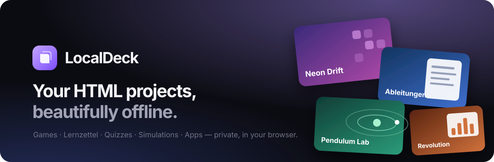
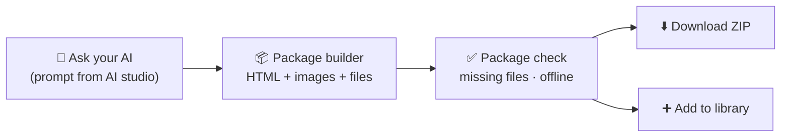

<p align="center">
  
</p>

<p align="center">
  <a href="https://b1progame.github.io/LOCALDECK/"></a>
  
  
</p>

<p align="center">
  
  
  
  
  
</p>

---

**LocalDeck** is a personal library for everything you build or learn with HTML: games, interactive *Lernzettel*, quizzes, simulations, presentations, tools and PDFs. Drop in a file, ZIP or folder. LocalDeck gives it artwork, sorts it by subject, and runs it in an isolated player, even with no internet connection.

Your library lives **in your browser**. Nothing is uploaded unless you create an encrypted share link yourself.

## ✨ Highlights

| | |
|---|---|
| 🎮 **One home for every project** | Games, learning sheets, apps, simulations, slides and PDFs, each with its own look and an *Open / Play / Read* button that fits. |
| 🎨 **Five themes + System** | Obsidian, Midnight, Forest, Rose and the light Pearl theme. Pick any accent color. |
| 🌍 **Five languages** | English, German, French, Spanish and Italian. Follows your browser, or pick one in Settings. |
| 🤖 **Connect an AI** | An AI that supports MCP builds projects, gives you a link and updates them later. |
| 🧠 **Scan on your device** | Every import is read on your device and gets name, subject, description and hashtags, without any download. A small Qwen model can write better texts. One runs in every browser without a graphics chip, only slower ([how](docs/LOCAL_AI.md)). |
| 🖼️ **Generated cover art** | Projects without a cover get unique artwork based on their type and title: pixel grids for games, ruled sheets for notes, orbits for simulations. |
| 📚 **Learning hub** | Subject tiles (Mathematik, Biologie, …), shelves for Lernzettel, quizzes, PDFs and presentations. |
| 🔒 **Sandboxed player** | Imported code runs in an opaque, isolated frame. It can't read your library. Fullscreen and immersive modes included. |
| ✦ **AI studio** | Turn what your AI made (HTML, images, extra files) into a finished LocalDeck ZIP, with manifest, cover and a package check. |
| 🔗 **Encrypted sharing** | Optional. Projects are encrypted in your browser, and the key never leaves the link. Links expire after 3 days. |
| 💾 **Backups** | Export the whole library as one ZIP and restore it on any device. |
| 📱 **Everywhere** | Desktop sidebar, iPad layout, phone tab bar. Installable as an app. |

## 🕹️ Try the demos

Turn on **Settings → Library → Demo projects** (or tap *Try the demo projects* on an empty Home screen). Eight real, offline examples are added, and turning the switch off removes only them:

| Demo | Type | What it shows |
|---|---|---|
| **Neon Drift** | Game | Canvas lane-dodger with keyboard and swipe controls and a best score |
| **Ableitungen verstehen** | Lernzettel | Rules, a live tangent explorer and self-checking exercises |
| **Photosynthese Quiz** | Quiz | Eight questions with instant feedback and explanations |
| **Pendulum Lab** | Simulation | Damped pendulum with live energy bars. Drag the bob |
| **Pixel Palette** | Tool | Color harmonies, lock and copy, export as CSS variables |
| **Die Französische Revolution** | Presentation | Eight slides with keyboard and swipe navigation |
| **Pomodoro Focus** | App | 25/5 timer with progress ring and task list |
| **Sorting Visualized** | Simulation | Bubble, insertion, merge and quick sort, step by step |

The demos live in [`src/demos`](src/demos). Each is a single HTML file with an embedded manifest, and they are good templates for your own projects.

## ✦ From AI chat to library in three steps



1. **PDF to project / Improve HTML**: copy a precise prompt for ChatGPT, Claude, Gemini or any other AI.
2. **Package builder**: drop the HTML it gave you, add its images and files, choose or **generate** a cover, and fill in the details. Most are read from the HTML automatically.
3. **Download ZIP** or **Add to my library**. The ZIP contains `index.html`, `localdeck.json`, the cover and every asset, ready to share or import anywhere.

## 🚀 Run it locally

```powershell
npm ci
npm run dev
```

Open <http://localhost:5468>. Other useful scripts:

```powershell
npm test            # importer, ZIP, sharing, worker and demo tests
npm run typecheck   # strict TypeScript
npm run build       # production build in dist/
```

Pushing to `main` builds and deploys to GitHub Pages through [`.github/workflows/pages.yml`](.github/workflows/pages.yml). In the repository's Pages settings, set the source to **GitHub Actions**.

## 📦 Project format

Put `index.html` at the root of a ZIP and add an optional `localdeck.json` next to it:

```json
{
  "schemaVersion": 1,
  "title": "Ableitungen verstehen",
  "type": "learning",
  "subject": "Mathematik",
  "topic": "Analysis",
  "description": "Interaktiver Lernzettel zu Ableitungsregeln",
  "tags": ["analysis", "übung"],
  "cover": "cover.png",
  "entry": "index.html"
}
```

`type` is one of `game`, `learning`, `app`, `tool`, `simulation`, `presentation`, `document`, `quiz` or `other`. A single HTML file can carry the same JSON inside `<script id="localdeck-manifest" type="application/json">`. Keep asset paths relative. Anything loaded from the internet won't work offline.

## 🔐 Privacy & security

- The library, files and history are stored in **IndexedDB on this device**. There's no account and no tracking. Visits are only counted, without cookies or identifiers.
- Imported HTML runs in an **opaque sandbox**, served by the service worker with a CSP `sandbox` header. Without the service worker, single-file projects run from an isolated `blob:` URL.
- Sharing is **opt-in**. ZIPs are AES-GCM encrypted in the browser, and the key stays in the link's `#fragment`. The optional Cloudflare Worker stores only ciphertext, and only for 3 days.

More detail: [Architecture](docs/ARCHITECTURE.md) · [Security](docs/SECURITY.md) · [Sharing setup](docs/SHARING.md) · [Branded emails](docs/EMAIL_TEMPLATES.md) · [Design system](docs/DESIGN_SYSTEM.md) · [Deployment](docs/DEPLOYMENT.md)

- No cookies. What is stored and who is contacted is on the [privacy page](https://b1progame.github.io/LOCALDECK/#/privacy) ([details](docs/PRIVACY.md)).

## 🗂️ Where things live

```text
src/
  main.tsx            app shell, routing, dialogs, player, settings
  views.tsx           Home, library pages, collections, project details
  shared.tsx          cards, rows, shelves, generated cover art
  packageBuilder.tsx  AI studio → ZIP export
  authAction.tsx      email verification & password reset page
  theme.ts            themes and accent colors
  demos/              the eight demo projects
  services/           IndexedDB, importer, ZIP, backups, sharing
cloudflare/           optional encrypted-sharing Worker (D1 + KV)
tests/                node:test suites
```

<p align="center"><sub>Made for the things you make. Saved on your device. Yours to keep.</sub></p>
